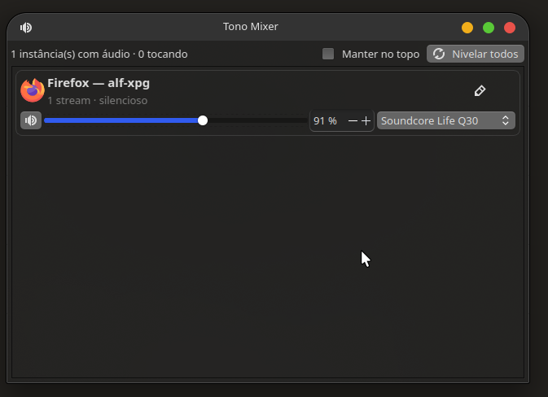

# Tono Mixer

### One mixer for every app instance. Your audio, your way.

Music, videos, notifications, and other sounds can all play at once — and you may not want them at the same volume or coming from the same device. Tono Mixer groups the audio streams from each app instance so you can manage them without affecting everything else.

It works with many kinds of apps, including Firefox, Chrome, VLC, Teams, and Slack.



## What you can do

- **Control audio by app instance:** adjust the volume for a whole group, or expand its card to control each stream individually.
- **Balance levels:** with one click, match stream and channel volumes when they differ.
- **Choose an output device:** send one app instance to your headphones and another to your speakers.
- **Pick up where you left off:** volume and output choices are saved per instance and restored when new streams appear.
- **See what's playing:** keep track of your apps from the system tray.
- **Jump in at the right moment:** open the window automatically when an app starts playing or creates a new stream.

## Installation

Requires Linux with PipeWire/PulseAudio accessible through `pactl`, Python 3, and PyQt6. Automatic startup uses `systemd --user`.

On Debian or Ubuntu, install the dependencies:

```bash
sudo apt install python3-pyqt6 pulseaudio-utils
```

Then, from the repository root:

```bash
./windowed/install.sh
```

The installer copies the app to `~/.local/share/linux-audio-balance`, creates the `audio-balance` command in `~/.local/bin`, adds an application menu shortcut, and enables the service for your graphical session.

## Get started

```bash
audio-balance          # opens the window or brings the existing one to the front
audio-balance --list   # lists detected groups and streams in the terminal
audio-balance --version
```

The service starts hidden in the system tray when your graphical session begins. Check its status with:

```bash
systemctl --user status linux-audio-balance.service
```

To start manually in tray-only mode:

```bash
audio-balance --hidden
```

## How grouping works

Tono Mixer tries to identify each app instance, not just the app name:

- **Flatpak apps:** uses instance data and, when available, the active profile.
- **Native apps:** uses the root process and profile options such as `--user-data-dir` and `-P`.

This helps keep the audio streams from the same app instance together, while keeping different profiles or accounts separate.

## Configuration

Preferences are stored in `~/.config/linux-audio-balance/config.json`. Open the tray menu and choose **Edit configuration…** to open the file. If you edit it manually, restart the service to apply the changes:

```bash
systemctl --user restart linux-audio-balance.service
```

| Option | Default | Description |
|---|---:|---|
| `popup_on_new_stream` | `true` | Opens the window when a new stream appears. |
| `popup_on_playback_start` | `true` | Opens the window when a stream starts playing. |
| `auto_hide_seconds` | `20` | Hides the popup after this many seconds without interaction; `0` keeps it open. |
| `popup_cooldown_seconds` | `15` | Minimum time between popups for the same group. |
| `restore_group_volume` | `true` | Restores saved volume and output when new streams appear. |
| `max_volume_percent` | `150` | Maximum value for volume controls. |
| `keep_on_top_when_popup` | `true` | Keeps the popup above other windows. |
| `hidden_apps` | `speech-dispatcher-dummy`, `sd_dummy`, `pactl` | App names or binaries to hide from the list. |
| `no_popup_apps` | `[]` | Apps that should not trigger popups; matches the app name, binary, or label, such as `Firefox`. |
| `ignore_event_sounds` | `true` | Prevents popups for event, notification, and accessibility sounds. |

The `groups` object stores per-instance data, including a custom label (`label`), volume (`volume`), and output device (`sink`).

## Uninstall

From the repository root:

```bash
./windowed/uninstall.sh
```

Uninstalling disables the service and removes the installed app. Your preferences remain in `~/.config/linux-audio-balance`.
